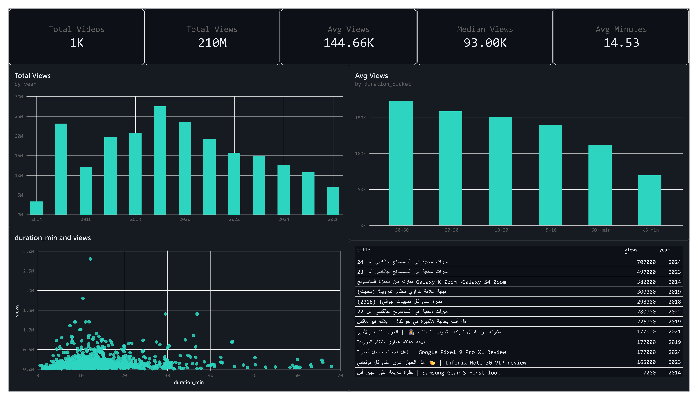

<div align="center">

# YT Channel Harvester

**An end-to-end analytics pipeline for public YouTube channels: scrape, clean, and visualise.**


</div>



---

## Contents

- [Summary](#summary)
- [Architecture](#architecture)
- [Repository layout](#repository-layout)
- [Getting started](#getting-started)
- [Configuration](#configuration)
- [Data model](#data-model)
- [Dashboard](#dashboard)
- [Sample results](#sample-results)
- [Data quality and limitations](#data-quality-and-limitations)
- [Troubleshooting](#troubleshooting)
- [Roadmap](#roadmap)
- [Responsible use](#responsible-use)
- [Author](#author)

---

## Summary

YT Channel Harvester extracts the complete video catalogue of a public YouTube channel and turns it into a decision-ready dashboard. It was built to answer practical content-strategy questions: how a channel's views are distributed over time, which video lengths perform best, and which videos lead the catalogue.

| Capability | Detail |
|---|---|
| Full-catalogue extraction | Headless Chrome with infinite-scroll handling; 1,593 videos collected in about 5 minutes |
| Fault tolerance | Stale-element retries, safe DOM access helpers, context-managed browser lifecycle |
| Multilingual support | UTF-8 with BOM output keeps Arabic titles intact in Excel and Power BI |
| Reproducible cleaning | Deterministic rules with before and after row counts |
| BI-ready output | Derived fields (duration, estimated date, buckets) that load straight into Power BI |

---

## Architecture


| Stage | Component | Input | Output |
|---|---|---|---|
| 1 | `01_scrape_channel.ipynb` | Channel URL | `output/<channel>_videos_<timestamp>.csv` |
| 2 | `02_clean_and_prepare.ipynb` | Raw CSV | `output/<channel>_videos_cleaned.csv`, `output/<channel>_powerbi.csv` |
| 3 | `03_channel_dashboard.pbix` | Power BI CSV | Interactive report |

---

## Repository layout

```
yt-channel-harvester/
├── 01_scrape_channel.ipynb        Selenium scraper and raw export
├── 02_clean_and_prepare.ipynb     Cleaning and feature engineering
├── 03_channel_dashboard.pbix      Power BI report
├── README.md
├── docs/
│   ├── dashboard_preview.png      Screenshot used in this README
│   └── dashboard_preview.pdf      Exported report page
└── output/                        Generated datasets
```

---

## Getting started

**Prerequisites:** Python 3.9 or later, Google Chrome, and Power BI Desktop for the dashboard.

```bash
pip install selenium webdriver-manager pandas
```

1. **Scrape.** Set the target channel in the configuration cell of `01_scrape_channel.ipynb` and run all cells. A raw CSV is written to `output/`.
2. **Clean.** Point `INPUT_FILE` in `02_clean_and_prepare.ipynb` at the raw CSV and run all cells. The cleaned and Power BI files are written to `output/`.
3. **Visualise.** Open `03_channel_dashboard.pbix`. If the source path differs on your machine, go to Home, Transform data, Data source settings, Change source, and select `output/<channel>_powerbi.csv`.

---

## Configuration

All scraper settings live in one cell of `01_scrape_channel.ipynb`.

| Parameter | Default | Description |
|---|---|---|
| `CHANNEL_URL` | n/a | Full URL of the channel's `/videos` tab |
| `CHANNEL_HANDLE` | n/a | Handle used to name the output file, for example `@YourChannel` |
| `MAX_VIDEOS` | `0` | Maximum videos to collect; `0` collects all |
| `SCROLL_PAUSE` | `2.5` | Seconds to wait between scroll steps |
| `PAGE_TIMEOUT` | `30` | Seconds to wait for the page to load |
| `MAX_RETRIES` | `3` | Retries per video card on stale elements |

To watch the browser while developing, call `build_driver(headless=False)`.

---

## Data model

**Source columns**

| Column | Type | Description |
|---|---|---|
| `title` | text | Video title |
| `url` | text | Watch URL |
| `views` | integer | View count parsed from text such as `1.2M views` |
| `upload_date` | text | Relative age as displayed, for example `2y ago` |
| `duration` | text | Spelled-out length, for example `17 minutes, 1 second` |

**Derived columns (Power BI file)**

| Column | Type | Description |
|---|---|---|
| `duration_sec`, `duration_min` | integer, decimal | Duration in seconds and in minutes |
| `approx_upload_date` | date | Estimated upload date from the relative age |
| `year`, `year_month` | integer, text | Calendar groupings |
| `video_id` | text | 11-character YouTube video ID |
| `duration_bucket` | text | `<5 min`, `5-10`, `10-20`, `20-30`, `30-60`, `60+ min` |
| `title_lang` | text | `Arabic` or `English`, detected from the title script |

---

## Dashboard

| Visual | Question answered |
|---|---|
| KPI cards | How large is the catalogue and what is the typical video? |
| Total views by year | Which upload years drive the most views? |
| Average views by duration bucket | Which video lengths perform best? |
| Duration vs views scatter | Are there outliers, and does length predict reach? |
| Top videos table | Which individual videos lead the catalogue? |

Core measures:

```DAX
Total Videos = COUNTROWS(AndroidBasha_powerbi)
Total Views  = SUM(AndroidBasha_powerbi[views])
Avg Views    = DIVIDE([Total Views], [Total Videos])
Median Views = MEDIAN(AndroidBasha_powerbi[views])
Avg Minutes  = AVERAGE(AndroidBasha_powerbi[duration_min])
```

Substitute your own table name if it differs.

---

## Sample results

Dataset: the AndroidBasha channel, scraped on 21 October 2026.

| Metric | Value |
|---|---|
| Videos scraped, then retained after cleaning | 1,593, then 1,449 |
| Total views | about 209.6 million |
| Average and median views per video | about 144.7 thousand and 93 thousand |
| Average duration | 14.5 minutes |
| Peak upload year by total views | 2019, at about 27.4 million |
| Best-performing length | 30 to 60 minutes, at about 174 thousand average views |

---

## Data quality and limitations

- **Cleaning impact:** 144 of 1,593 rows (9.0 percent) were removed. 140 had no usable `upload_date` and 4 had no `views`.
- **Scraping artefacts:** some `upload_date` cells hold non-date text such as a channel name. The cleaning step filters them out.
- **Approximate dates:** YouTube exposes only relative ages such as `2y ago`, so `approx_upload_date` is accurate to about a month for recent videos and about a year for older ones. Year-level trends are indicative.
- **Rounded view counts:** the channel page shows abbreviated counts (for example `1.2M`), so `views` is rounded accordingly.
- **Markup dependence:** the scraper relies on YouTube's current page structure and may need selector updates after site changes.

---

## Troubleshooting

| Symptom | Likely cause and fix |
|---|---|
| `NameError: name 'logger' is not defined` | Run the imports and logging cell before later cells |
| `SyntaxWarning: invalid escape sequence "\A"` | Use forward slashes in paths, for example `"output/file.csv"`, or a `Path` object |
| Scraper returns zero cards | YouTube changed its markup; update the selectors in the scraper class |
| Arabic text appears garbled in Excel | Open the file as UTF-8, or import it through Data, From Text/CSV |
| Power BI cannot find the file | Update the path in Data source settings |
| `Failed to resolve name` in a DAX measure | The table name in the formula does not match the Data pane; use the exact name |

---

## Roadmap

- [ ] Command-line entry point to replace notebook-only execution
- [ ] Optional YouTube Data API source for exact upload dates and counts
- [ ] Multi-channel comparison page in the dashboard
- [ ] Scheduled refresh of the dataset
- [ ] Unit tests for the parsing helpers

---

## Responsible use

Collect only public data, keep request rates modest, and follow YouTube's Terms of Service and the laws that apply to you. For production or commercial use, prefer the official YouTube Data API.

---

## Author

**Ali Essam**, Cairo, Egypt
GitHub: [ali-essam2002](https://github.com/ali-essam2002)